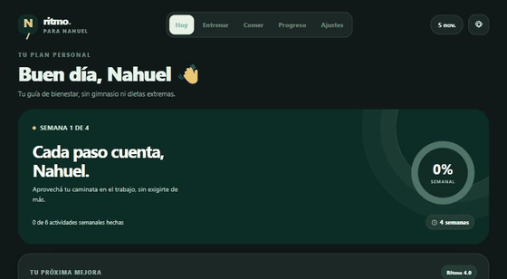
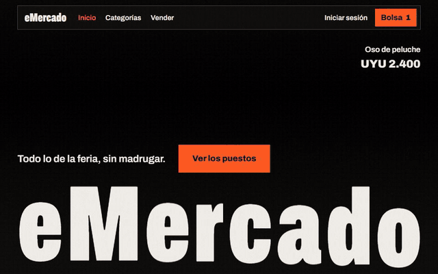

  
  
  

## Hola, soy Nahuel

Hago productos web de punta a punta: desde limpiar millones de filas de datos hasta la pantalla donde cobran sentido. Me gustan los proyectos que se pueden tocar, como un mapa 3D, un juego en el navegador o una app que uso todos los días.

Estudio **Ingeniería en Informática** en la Universidad Católica del Uruguay.

## Proyecto principal

<table>
  <tr>
    <td width="58%">
      
    </td>
    <td width="42%" valign="top">
      <h3>🛒 Canasta UY</h3>
      
<b>¿Dónde sale más barato?</b> Un mapa 3D de Uruguay donde cada columna es un supermercado real. Compará cadenas, seguí la historia de cada precio y armá tu canasta.

      <ul>
        <li><b>20.223.608</b> precios procesados</li>
        <li><b>751</b> locales en todo el país</li>
        <li><b>110</b> tests automatizados</li>
      </ul>
      
<a href="https://nahuelbenitezs.github.io/canasta-uy/"><b>Abrir la web</b></a> · <a href="https://github.com/nahuelbenitezs/canasta-uy">Ver el código</a>

      
    </td>
  </tr>
</table>

## Otros proyectos

<table>
  <tr>
    <td width="33%" valign="top">
      
      <h3>⚡ Anime Clash 3D</h3>
      
Juego de peleas en 3D para el navegador, pensado para jugar desde el celular.

      
<a href="https://nahuelbenitezs.github.io/Anime-Clash-3D/"><b>Jugar</b></a> · <a href="https://github.com/nahuelbenitezs/Anime-Clash-3D">Código</a>

    </td>
    <td width="33%" valign="top">
      
      <h3>🎯 Valopedia</h3>
      
Wiki de VALORANT en español e inglés, con rueda de agentes, habilidades, mapas y armas que se actualiza sola en cada parche.

      
<a href="https://nahuelbenitezs.github.io/valopedia/"><b>Explorar</b></a> · <a href="https://github.com/nahuelbenitezs/valopedia">Código</a>

    </td>
    <td width="33%" valign="top">
      
      <h3>🌿 Ritmo</h3>
      
App instalable de bienestar con entrenamiento, alimentación y hábitos, sin cuenta ni suscripción.

      
<a href="https://nahuelbenitezs.github.io/Ritmo/"><b>Abrir</b></a> · <a href="https://github.com/nahuelbenitezs/Ritmo">Código</a>

    </td>
  </tr>
  <tr>
    <td width="33%" valign="top">
      
      <h3>🛒 eMercado</h3>
      
E-commerce de demostración con WebGL y scroll coreografiado, migrado a Angular desde un obligatorio de Jóvenes a Programar.

      
<a href="https://nahuelbenitezs.github.io/Proyecto-Obligatorio/"><b>Abrir</b></a> · <a href="https://github.com/nahuelbenitezs/Proyecto-Obligatorio">Código</a>

    </td>
  </tr>
</table>

## Con qué trabajo

<table>
  <tr>
    <td><b>Web</b></td>
    <td></td>
  </tr>
  <tr>
    <td><b>Backend y datos</b></td>
    <td></td>
  </tr>
  <tr>
    <td><b>Herramientas</b></td>
    <td></td>
  </tr>
</table>

## Mi actividad

## Contacto

Escribime por [LinkedIn](https://www.linkedin.com/in/nahuel-ben%C3%ADtez-990385203/) o mirá más en mi [portafolio](https://nahuelbenitezs.github.io/).
