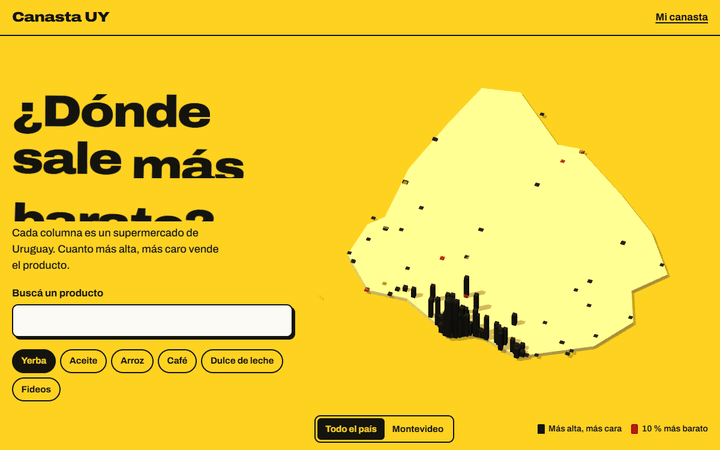
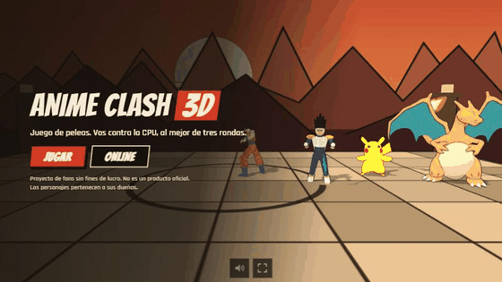
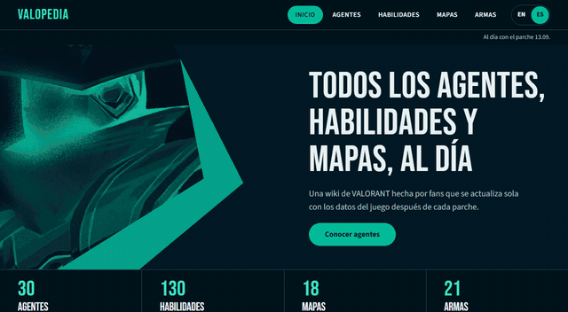
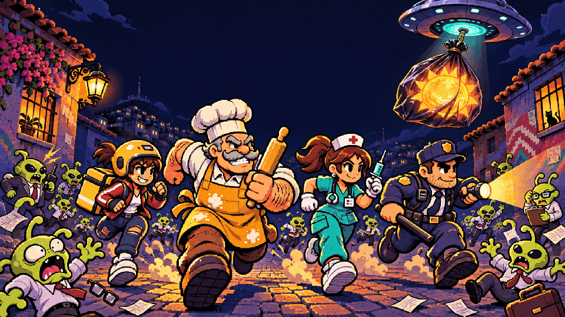

  
  
  

<a href="#proyecto-principal">Proyectos</a> · <a href="#con-qué-trabajo">Tecnologías</a> · <a href="#en-vivo">En vivo</a> · <a href="#contacto">Contacto</a>

## Hola, soy Nahuel

Hago productos web de punta a punta: desde limpiar millones de filas de datos hasta la pantalla donde cobran sentido. Me gustan los proyectos que se pueden tocar, como un mapa 3D, un juego cooperativo en el navegador o una tienda llena de movimiento.

Estudio **Ingeniería en Informática** en la Universidad Católica del Uruguay.

## Proyecto principal

<table>
  <tr>
    <td width="58%">
      
    </td>
    <td width="42%" valign="top">
      <h3>🛒 Canasta UY</h3>
      
<b>¿Dónde sale más barato?</b> Un mapa 3D de Uruguay donde cada columna es un supermercado real. Bajá por la historia de los precios, compará cadenas y armá tu canasta con datos abiertos.

      <ul>
        <li><b>20.223.608</b> precios procesados</li>
        <li><b>751</b> locales en todo el país</li>
        <li><b>292</b> productos para comparar</li>
      </ul>
      
<a href="https://nahuelbenitezs.github.io/canasta-uy/"><b>Abrir la web</b></a> · <a href="https://github.com/nahuelbenitezs/canasta-uy">Ver el código</a>

      
    </td>
  </tr>
</table>

## Otros proyectos

<table>
  <tr>
    <td width="50%" valign="top">
      
      <h3>⚡ Anime Clash 3D</h3>
      
Peleas en 3D en el navegador, con cuatro luchadores, tres dificultades y salas online para dos. También se juega en el celular con controles táctiles.

      
<a href="https://nahuelbenitezs.github.io/Anime-Clash-3D/"><b>Jugar</b></a> · <a href="https://github.com/nahuelbenitezs/Anime-Clash-3D">Código</a>

    </td>
    <td width="50%" valign="top">
      
      <h3>🛍️ eMercado</h3>
      
E-commerce de demostración con estética de feria uruguaya, fondo WebGL y scroll coreografiado, hecho con Angular y Motion.

      
<a href="https://nahuelbenitezs.github.io/Proyecto-Obligatorio/"><b>Abrir</b></a> · <a href="https://github.com/nahuelbenitezs/Proyecto-Obligatorio">Código</a>

    </td>
  </tr>
  <tr>
    <td width="50%" valign="top">
      
      <h3>🎯 Valopedia</h3>
      
Wiki de VALORANT en español e inglés, con rueda de agentes, habilidades, mapas y armas. Se actualiza sola después de cada parche.

      
<a href="https://nahuelbenitezs.github.io/valopedia/"><b>Explorar</b></a> · <a href="https://github.com/nahuelbenitezs/valopedia">Código</a>

    </td>
    <td width="50%" valign="top">
      
      <h3>🌙 Turno Noche</h3>
      
Beat 'em up 2D cooperativo para hasta 4 personas, en la misma pantalla u online. Cinco niveles y cinco jefes para recuperar el amanecer que se robaron.

      
<a href="https://nahuelbenitezs.github.io/turno-noche/"><b>Jugar</b></a> · <a href="https://github.com/nahuelbenitezs/turno-noche">Código</a>

    </td>
  </tr>
</table>

## Con qué trabajo

Mi stack por área

 

<table>
  <tr>
    <td><b>Web</b></td>
    <td></td>
  </tr>
  <tr>
    <td><b>Backend y datos</b></td>
    <td></td>
  </tr>
  <tr>
    <td><b>Herramientas</b></td>
    <td></td>
  </tr>
</table>

## En vivo

Esta sección se regenera todos los días con datos públicos de GitHub.

 

## Contacto

Escribime por [LinkedIn](https://www.linkedin.com/in/nahuel-ben%C3%ADtezs/) o mirá más en mi [portafolio](https://nahuelbenitezs.github.io/).
